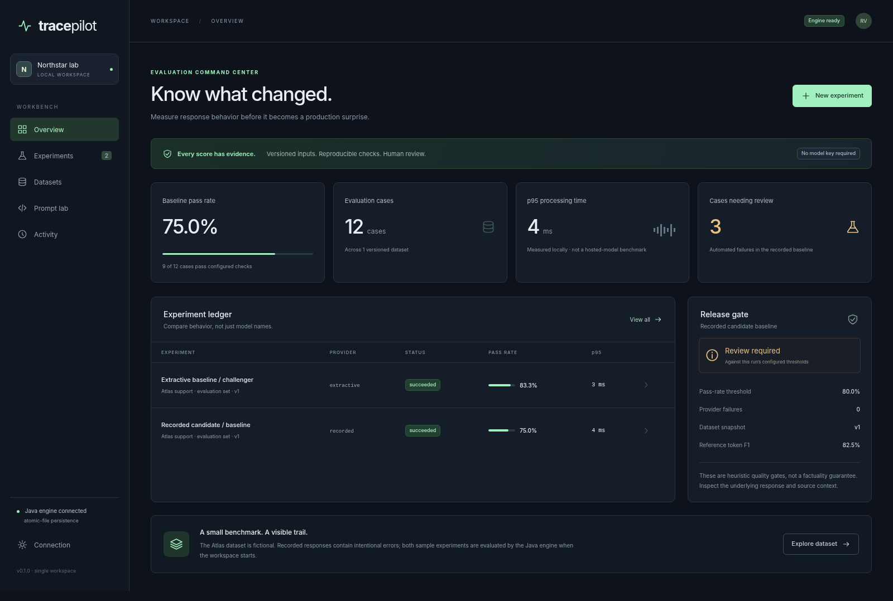

# TracePilot

**Know what changed before an AI response reaches a user.**

Java 21 · Spring Boot API adapter · offline JDK launcher · real persistence · browser-native interface



## Why this exists

A response can look convincing while failing a reference check, ignoring context, producing invalid JSON, or taking too long. TracePilot makes those failures inspectable at the individual-case level instead of hiding them behind one dashboard score.

## Implemented capabilities

- Versioned datasets and prompt templates, with immutable input snapshots inside every run.
- A persisted evaluation queue with idempotency keys, cancellation, progress, partial evidence, and explicit restart behavior.
- Six inspectable heuristic evaluators: exact match, multiset token F1, source-token support, required phrases, JSON syntax, and expected-refusal phrases.
- Recorded-response and extractive baselines that run offline; optional real Ollama generation through a bounded Java HTTP client.
- Per-case evidence inspection, human annotations with optimistic revisions, paired run comparisons, and CSV/JSON exports.
- Measured local latency percentiles, clearly labelled token estimates, configurable gates, and optional operator-supplied cost inputs.

## Start in one command

Install a **full JDK 21 or newer**, then run from this repository:

```bash
./run.sh
```

Windows PowerShell:

```powershell
.\run.ps1
```

Open **http://localhost:8311**. First startup seeds a fictional example workspace and computes its jobs. No API key, Maven, Node installation, Docker daemon, or paid service is required for this mode. The launcher compiles the actual Java engine; the interface is not a screenshot or hard-coded mock.

The shell/PowerShell scripts read environment variables, **not `.env` files**. Local state is written to `.local/`, which is excluded from Git. One process owns each workspace. Stop with Ctrl+C.

## Spring Boot mode

The Spring MVC adapter calls the **same domain services and security boundary** as the offline launcher. It is not a separate placeholder backend.

```bash
mvn -B -ntp verify
java -jar spring/target/tracepilot-spring-0.1.0.jar
```

The Maven build downloads dependencies. Stop the offline launcher first, or choose a different `PORT`. PostgreSQL is available through the JDBC store; a Spring/PostgreSQL deployment is defined in `compose.yaml`:

```bash
python scripts/init_env.py
# Review the newly generated .env before continuing.
docker compose up --build
```

Compose binds the host port to loopback and requires the generated workspace key. Enter `APP_TOKEN` in the interface's connection dialog. See [operations](docs/OPERATIONS.md) before using external providers or changing network exposure.

**Validation boundary:** the Java/JDK application, native tests, browser-module tests, isolated HTTP workflows, and offline DOM rendering were exercised in the delivery environment. Maven/Spring, H2, PostgreSQL, Docker, live Ollama, and live GitHub were not executed there because their required packages/services or network access were unavailable. The repository includes Spring/H2 tests and CI jobs, but does not display a fabricated passing build badge.

## Take the guided demo

1. Open the seeded recorded-response experiment and inspect a failed case.
2. Compare the recorded and extractive runs on the same dataset version.
3. Edit a dataset to create a new version, then observe that the old run snapshot is unchanged.
4. Add a human annotation, export the evidence, and run `python scripts/demo.py` for another real comparison.

```bash
python scripts/demo.py
```

The CLI stores new example evidence in the selected running workspace. It uses Python's standard library as an HTTP client; the product algorithms remain in Java.

## Tests

```bash
./scripts/check.sh
python scripts/smoke_http.py
```

PowerShell equivalents: `./scripts/check.ps1`, then `python scripts/smoke_http.py`.

The current native suite has **62 passing Java test executions** and **8 passing browser-module tests**. The HTTP smoke starts an isolated JVM and temporary workspace, verifies real HTTP requests, then shuts it down. Tests do not require paid inference. Node 22+ is needed only for browser-module tests; the app itself serves native ES modules.

## Code map

| Path | Responsibility |
|---|---|
| `engine/src/main/java/dev/portfolio/tracepilot` | Product algorithms and workflows |
| `engine/src/main/java/dev/portfolio/foundation` | Transactions, queue, HTTP contracts, validation, provider client |
| `spring/` | Spring Boot MVC adapter, Actuator, JDBC dependency, MVC/H2 tests |
| `standalone/` | Dependency-free JDK HTTP adapter and launcher |
| `web/` | Product-specific interface and pure-module tests |
| `tests/` | Executable Java engine and infrastructure contracts |
| `examples/` | Fictional, reproducible input fixtures |
| `scripts/` | Launch checks, real HTTP smoke, CLI demo, environment initialization |
| `docs/` | Architecture, algorithms, API, operations, limitations, demo, roadmap |

## Scope, honestly

The checks are lexical heuristics, not ground-truth hallucination detection. Recorded/extractive timing measures local processing, not hosted-model performance. Token estimates are not model-tokenizer counts. The application evaluates bounded datasets; it is not a distributed trace collector or a replacement for a production observability system.

This is a single-workspace engineering application, not a multi-tenant production SaaS. The initial repository has no claimed development duration, production customers, or fabricated performance improvements. The [12-week roadmap](docs/ROADMAP.md) describes **future work**, not a reconstructed history.

## Engineering documentation

[Architecture](docs/ARCHITECTURE.md) · [Algorithms](docs/ALGORITHMS.md) · [API](docs/API.md) · [Operations](docs/OPERATIONS.md) · [Security](SECURITY.md) · [Testing](docs/TESTING.md) · [Project status](docs/PROJECT_STATUS.md) · [Walkthrough](docs/WALKTHROUGH.md) · [Publishing](docs/PUBLISHING.md)

## License

MIT for this repository's source. Review the licenses of dependencies before redistribution. No dependency source, font files, private tokens, generated runtime database, or artificial Git history is included.

## Pull requests and releases

Changes are checked by GitHub Actions before release. See [the release guide](docs/RELEASING.md) for PR checks, required repository settings, tested container images, and deployment setup.
