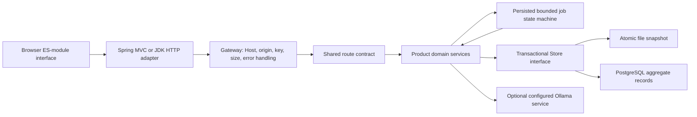
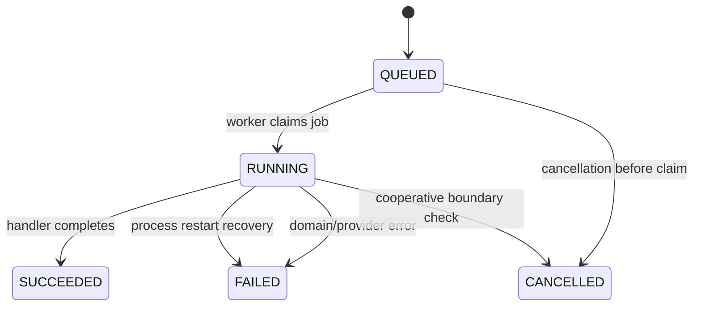

# TracePilot: architecture

## Boundaries

The Java engine is framework-independent by design. An HTTP handler maps a request into a domain call, and the Spring adapter performs only transport adaptation. This makes the central invariants testable without a Spring context, while still providing a real Spring Boot deployment path.

The browser uses ordinary ES modules, `fetch`, native forms/dialogs, and product-specific CSS. No React build chain, remote CDN, or copied UI template is required. Business outcomes are computed on the server; the browser formats and presents the returned evidence.

## Product decomposition

- [`CaseSpec.java`](../engine/src/main/java/dev/portfolio/tracepilot/CaseSpec.java)
- [`DatasetService.java`](../engine/src/main/java/dev/portfolio/tracepilot/DatasetService.java)
- [`PromptTemplate.java`](../engine/src/main/java/dev/portfolio/tracepilot/PromptTemplate.java)
- [`EvaluationMetrics.java`](../engine/src/main/java/dev/portfolio/tracepilot/EvaluationMetrics.java)
- [`ResponseProviders.java`](../engine/src/main/java/dev/portfolio/tracepilot/ResponseProviders.java)
- [`RunService.java`](../engine/src/main/java/dev/portfolio/tracepilot/RunService.java)
- [`RunSummary.java`](../engine/src/main/java/dev/portfolio/tracepilot/RunSummary.java)
- [`RunComparison.java`](../engine/src/main/java/dev/portfolio/tracepilot/RunComparison.java)

## Persistence model

`Store.read` and `Store.write` define the transaction boundary. Aggregates are JSON-shaped maps so both adapters serialize the exact same public contract. This is a deliberate tradeoff: less framework coupling, but less compile-time DTO coverage than a typed persistence model. Input validation and contract tests compensate only partially; typed DTO expansion is on the roadmap.

`MemoryStore` supplies copy-on-write transactions and defensive copies. `FileStore` serializes a schema-versioned workspace to a staging file, flushes it, then atomically replaces the old snapshot. An OS file lock prevents two JVMs from writing the same directory. Corruption fails closed; it is not silently reset. The 32 MiB cap makes this a bounded local store, not a general database engine.

`JdbcStore` stores each aggregate in a `(bucket, record_id)` row rather than persisting one giant workspace blob. Write transactions acquire a database mutex row, then use prepared statements. Reads use repeatable-read snapshots; writes use read-committed isolation after mutex acquisition. This serializes workspace writes deliberately. It does not turn the in-process scheduler into a distributed queue. Run one application instance per workspace even when using PostgreSQL.

## Durable job state machine

Two workers consume at most 64 pending jobs. An idempotency key is hashed with job kind and compared against the submitted payload fingerprint. Repeating the same key and payload returns the original job; reusing the key for different input returns HTTP 409. This is not an exactly-once guarantee for arbitrary external services.

Cancellation is cooperative. A request already in flight may finish before the next cancellation check. On restart, prior `RUNNING` records become `FAILED`; they are not automatically replayed into a paid or stateful provider. Partial evidence is retained where the product supports it. The user can inspect the failure and submit an explicit retry.

## Failure and trust boundaries

A configured provider URL comes from the operator's environment, never from an arbitrary API URL field. Redirects are disabled, responses are size-bounded, and streaming-body reads have their own deadline. These controls reduce accidental SSRF/availability exposure; they do not create a hardened public SaaS boundary.

The gateway checks expected Host values, rejects foreign-origin writes, bounds JSON bodies, optionally verifies a workspace key, and returns request IDs with safe errors. It does not provide accounts, roles, SSO, rate-limiting tiers, or tenant isolation. See SECURITY.md.

## Deliberate non-goals

The foundation is shared across the three portfolio repositories, but the domain engines and interfaces are different. Shared infrastructure is not three independent inventions. Each repository is self-contained so it can be cloned, tested, and changed without a sibling repository or private package registry.

Do not add Redis, Kafka, Kubernetes, Python microservices, or a vector database merely to increase the tool count. Add infrastructure only when a demonstrated workload or reliability requirement justifies its operational cost.
